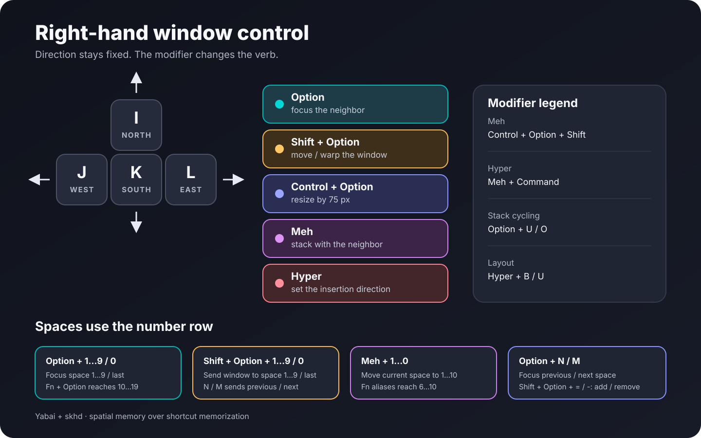

# macOS window-manager dotfiles

My keyboard-first setup for [Yabai](https://github.com/asmvik/yabai), [skhd](https://github.com/asmvik/skhd), and [JankyBorders](https://github.com/FelixKratz/JankyBorders).

The idea is simple: the right hand stays on an inverted-T **I/J/K/L** cluster, like a right-handed WASD. The direction never changes; modifiers change the verb.



## The spatial language

| Layer | I / J / K / L does |
| --- | --- |
| `Option` | Focus north / west / south / east |
| `Shift + Option` | Move the window in that direction |
| `Control + Option` | Resize that edge by 75 px |
| `Meh` | Stack with the neighbor in that direction |
| `Hyper` | Choose where the next window is inserted |

`Meh` means `Control + Option + Shift`. `Hyper` adds `Command`.

## Spaces

The number row uses physical keycodes, so it keeps working when I change keyboard layouts.

| Shortcut | Action |
| --- | --- |
| `Option + 1…9` | Focus space 1…9 |
| `Option + 0` | Focus the last space |
| `Fn + 1…9` | Alternate way to focus space 1…9 |
| `Fn + Option + 1…0` | Focus space 10…19 |
| `Shift + Option + 1…9` | Send the focused window to space 1…9 |
| `Shift + Option + 0` | Send the window to the last space |
| `Meh + 1…0` | Move the current space to position 1…10 |
| `Option + N / M` | Focus the previous / next space |
| `Shift + Option + N / M` | Send the window to the previous / next space |
| `Shift + Option + = / -` | Create / destroy a space |

There are a few deliberate aliases in [.skhdrc](.skhdrc) for whichever keys are easiest to reach at the time.

## Other useful bindings

| Shortcut | Action |
| --- | --- |
| `Option + U / O` | Next / previous window in a stack |
| `Shift + Option + Space` | Toggle floating |
| `Option + F` | Toggle Yabai zoom |
| `Shift + Option + F` | Toggle native full screen |
| `Hyper + B / U` | Set the space to BSP / floating layout |
| `Control + Command + A` | Toggle the ChatGPT scratchpad |
| `Option + Command + E` | Toggle the Telegram scratchpad |
| `Command + Option + S` | Toggle the Spotify scratchpad |
| `Control + Z / X / C / V` | Previous tab / next tab / close tab / new tab in supported browsers |
| `Option + D` | Open [Homerow](https://www.homerow.app/) |

The Yabai file also defines floating rules for utility windows and scratchpads for Spotify, Telegram, Gemini, MacTube, and ChatGPT. Delete or adapt those app-specific rules freely.

The ChatGPT, Telegram, and Spotify bindings use a small self-healing wrapper around Yabai's native scratchpad command. Hiding still orders out only the selected window, so other windows from that application remain visible. When showing, the wrapper also activates the owning application, which recovers the same hidden or stale Accessibility state that clicking its Dock icon repairs. If Yabai has lost the scratchpad assignment, the wrapper reapplies that application's existing named rule and retries. Compact state-only diagnostics, without window titles, are written to `~/Library/Logs/yabai-scratchpad.log` and rotated at 1 MB.

### Scratchpad recovery on restart

The final block in [.yabairc](.yabairc) runs once whenever Yabai loads its configuration. Yabai discovers already-open windows before the configuration adds its rules, so `yabai -m rule --apply` reapplies the new rules to those windows.

The following `for` loop checks each named scratchpad with `jq`. If its window exists and is currently visible, `yabai -m window --toggle` hides it. This makes recovered scratchpads start in the same hidden state as new scratchpads. It does **not** open applications, close windows, poll in the background, or keep running after startup.

## Install

1. Read Yabai's [installation](https://github.com/asmvik/yabai/wiki/Installing-yabai-%28latest-release%29) and [scripting-addition](https://github.com/asmvik/yabai/wiki/Disabling-System-Integrity-Protection) instructions first. Several bindings here need the scripting addition and a compatible SIP configuration.
2. Review the four third-party Homebrew projects linked in this README, then explicitly trust their formulae. This is intentionally not automated:

   ```sh
   brew trust --formula asmvik/formulae/yabai
   brew trust --formula asmvik/formulae/skhd
   brew trust --formula felixkratz/formulae/borders
   brew trust --formula laishulu/macism/macism
   ```

3. Install the command-line dependencies:

   ```sh
   brew bundle
   ```

4. Preview what the installer will change:

   ```sh
   ./scripts/install.sh --dry-run
   ```

5. Install the files and reload the services:

   ```sh
   ./scripts/install.sh
   ```

The installer saves the previous files under `~/.dotfiles-backups/` before replacing them. It installs the self-healing scratchpad helper under `~/.config/yabai/`. Yabai is restarted so its rules are reapplied; skhd watches `.skhdrc` and reloads it automatically when the file changes. The installer does not install or change Yabai's scripting-addition/SIP setup.

## What needs partial SIP

Yabai and most of this setup work with SIP fully enabled. Partial SIP is only needed so Yabai can load its scripting addition into Dock.app. Follow Yabai's [current partial-SIP instructions](https://github.com/asmvik/yabai/wiki/Disabling-System-Integrity-Protection); the installer in this repository deliberately does not change Mac security settings.

With SIP fully enabled, these parts of this configuration will not work:

| Feature | Affected configuration and shortcuts |
| --- | --- |
| Create or destroy Spaces | `Shift + Option + = / -` |
| Reorder the current Space | `Meh + 1…0`, `Meh + Fn + 1…5`, and `Shift + Option + , / .` |
| Send a window to another Space | `Shift + Option + 1…9 / 0`, `Fn + Shift + Option + 1…5`, and `Shift + Option + N / M` on current macOS releases |
| Scratchpad windows | The Spotify, Telegram, Gemini, MacTube, and ChatGPT rules; `Control + Command + A`; `Option + Command + E / S`; and the startup recovery block explained above |
| Window transparency and shadow removal | The 90% inactive opacity, `window_shadow off`, `Hyper + O`, and `Meh + P / O` |
| Yabai window animation control | `window_animation_duration 0.0` |
| Sticky windows and related window-layer features | `Meh + S` and the sticky Picture-in-Picture rule |

With SIP enabled, these important parts still work:

- BSP tiling, padding, gaps, floating rules, mouse controls, and JankyBorders.
- `Option + I/J/K/L` focus, `Shift + Option + I/J/K/L` warp, resize, stack, insert, rotate, mirror, balance, zoom, floating, and native full screen.
- Focusing existing Spaces with `Option + 1…9 / 0`, `Fn + 1…9 / 0`, `Fn + Option + 1…0`, or the previous/next aliases. Yabai added SIP-enabled Space focusing in [version 7.1.19](https://github.com/asmvik/yabai/blob/master/CHANGELOG.md).
- Browser, keyboard-layout, Homerow, Barik notification, and media-helper shortcuts that do not invoke a SIP-dependent Yabai command.

JankyBorders is separate from Yabai's own `window_shadow` setting, so the teal focus border continues to work with SIP enabled. Check `man yabai` after upgrading because Apple and Yabai can change these boundaries between releases.

## Optional integrations

- [`jq`](https://jqlang.github.io/jq/) is used to look up space numbers.
- [`macism`](https://github.com/laishulu/macism) gates two phonetic keyboard-layout helpers.
- [Homerow](https://www.homerow.app/) provides keyboard-driven clicking.
- My [Barik fork](https://github.com/jerechinsky/barik) shows space/window feedback. The `notifyutil` messages are harmless when Barik is not installed; remove them if you prefer.

## Validation

Run:

```sh
./scripts/validate.sh
```

It checks the shell syntax, duplicate skhd bindings, the core I/J/K/L layers, the SVG, accidental home-directory paths, and whitespace errors.

Tested on macOS 15.7.7 (Apple Silicon) with Yabai 7.1.24, skhd 0.3.9, and JankyBorders 1.8.4. App names and security requirements can change between macOS versions.

## What is deliberately not here

This repository contains active window-management configuration only. Old disabled experiments, machine-specific paths, and personal application data are excluded. Machine-specific Barik configuration is not duplicated here; Barik documents its own settings.

## License

[MIT](LICENSE). Yabai, skhd, JankyBorders, macism, Homerow, and Barik are separate projects with their own authors and licenses.

## Tabs Outliner desktop

`place-tabs-outliner.zsh` keeps the Work and Personal Outliners in one left
stack (23% width), and ordinary managed Brave Beta windows on that desktop in
one right stack. It follows the `tabs-outliner-home` label on the main display,
falling back to that display's first non-fullscreen desktop.

Creation, standalone Outliner title changes, focus, restoration from minimization, and Space/display
transitions reconcile the layout. Geometry events are excluded to prevent a
feedback loop. Bursts share one worker with a trailing refresh, and inactive
desktops reconcile when revisited. Standalone Outliner titles are matched
exactly so an ordinary browser tab showing Outliner stays in the right stack.
Browser windows on other desktops, floating utilities, and
minimized/hidden windows are excluded. If TV Player is on the home desktop,
reconciliation pauses to avoid indirectly resizing it. With no ordinary browser
on the desktop, the Outliners fill the available tile until a browser arrives.

The profile sync uses raise without transferring keyboard focus. The reconciler
also reapplies it after stacking, so the last stacked Outliner cannot override
the focused browser's profile.
